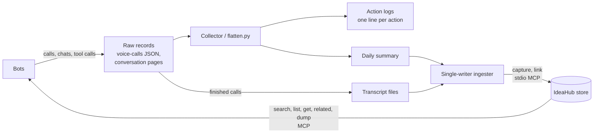

# Sidecars: adapters running next to ideahub_mcp

These pieces run on Michael's machine **outside this package**. They are not
modifications to `ideahub_mcp`: they install the published package unchanged and
talk to it only through its normal MCP tools over stdio. They are documented here
so the intended deployment shape is visible. Paths are shown generically
(`~/services/...`).

| Sidecar                      | Kind               | Status                                 |
| ---------------------------- | ------------------ | -------------------------------------- |
| Post-call transcript skill   | agent skill        | in use                                 |
| Call-transcript ingester     | background process | in use                                 |
| Daily ingester health check  | scheduled routine  | in use                                 |
| Daily bot activity log       | scheduled routine  | in progress (collection started only)  |

## 1. Post-call transcript skill

An instruction set that agents follow after a voice call ends:

1. Find the call's transcript file in the shared transcripts folder. Match on the
   bot and the short call id in the file name.
2. Post the full transcript in the chat. If it is very long, post a summary and
   the file path instead.
3. Confirm the transcript reached IdeaHub by running `search` for the call id.

The skill only reads. It never writes to the store.

## 2. Call-transcript ingester

`~/services/call-transcripts/ingester.py`, controlled by `ctl.sh`
(`start | stop | status | once | search <query> | log [n]`).

It is the **single writer** for both the transcripts folder and the IdeaHub store.
On startup it takes an exclusive file lock (`state/ingester.pid`, which also stores
its process id). A second copy fails to get the lock and exits. That one-writer
rule avoids the crash seen when two server processes started against one store.

Every 15 seconds (`CT_INTERVAL`) it runs one pass:

1. **Export.** It scans each agent's `voice-calls/call-*.json` records and skips
   calls that have not ended. Each finished call is rendered as one markdown file
   in `~/Downloads/call-transcripts/`, named `YYYY-MM-DD_HHMM_<bot>_<callid>.md`.
   The file has frontmatter (call id, bot, start, end, duration), the turns as
   transcribed by speech-to-text, and the requests the call passed to the bot with
   their answers. Writes are atomic (temp file, then rename). A file is rewritten
   only when its content changes.
2. **Ingest.** It starts `ideahub_mcp` as a stdio MCP subprocess. Each `*.md` file
   whose SHA-256 it has not seen is sent to `capture` with:
   - `scope="calls"`, `actor="agent:call-transcript-ingester"`, and Michael as
     `originator`
   - tags `call-transcript`, `bot:<bot>`, `call:<id>`, and `date:<YYYY-MM-DD>`
   - `task_ref="call-<id>"` and `candidates=0`
   If a file's content changed since it was last ingested, the new idea is linked
   to the old one with `supersedes`. Each call is also linked `related` to the same
   bot's previous call. Progress is kept in `state/state.json`, keyed by hash and
   by file name, so a restart never loads the same content twice.
3. **Index.** It rebuilds `index.md` in the transcripts folder, newest first, with
   the IdeaHub id for each file.

The ingester currently registers Michael as an actor with a workaround: an
`archive` call on a missing id, which creates the actor and then fails. Once the
`register` tool from this branch is released, the ingester can call that instead.

**Planned:** a second input folder for daily activity summaries (see section 4).
These would be ingested the same way under `scope="activity"`. Work on this is in
progress, so check the script for its current state.

## 3. Daily ingester health check

A scheduled routine that runs around 7:00 AM US Central:

1. Read the process id from `state/ingester.pid` and check that the process is alive.
2. If it is alive, do nothing.
3. If it is down, start it once with `ctl.sh start`, confirm it came back, and send
   a short note to Michael. If the start fails, report the error lines.
4. Never start a second copy, and never start a second `ideahub_mcp` writer
   against the store.

It checks that the process is alive, not that it is healthy. A process that is
frozen but still running would pass the check.

## 4. Daily bot activity log (in progress)

A scheduled routine that runs around 6:00 PM US Central.

**Built so far:** the collection step. For each bot, the day's conversation record
is saved as raw pages under `~/services/activity-log/raw/<date>/<bot>/`. A record
includes messages, tool calls with their inputs and results, handoffs between bots,
and visible reasoning. The `logs/` and `summaries/` folders exist but are empty.

**Not built yet:**

- **`flatten.py`** turns the raw pages into one line per action:
  `time | bot | kind | tool | input summary | files touched | recipients | outcome`.
  Rows are deduplicated by tool call id. Secrets such as tokens, codes, and
  credentials are redacted before anything is written.
- **A daily summary** per day, written to `summaries/`. The ingester picks it up
  and captures it with `scope="activity"`.

## Trace / activity-log service

The sidecars above form one pipeline. Bots produce records. A collector flattens
them into logs and a daily summary. A single-writer ingester appends those to the
IdeaHub store. Bots read the store back through MCP.

Design rules:

- **One writer.** Only the ingester writes to the store. Bots and the collector
  write files. The ingester is the only process that turns files into IdeaHub entries.
- **Append-only.** Changed inputs become new entries linked with `supersedes`.
  Nothing is overwritten.
- **Provenance.** Each entry is written by the ingester and credited to its
  originator, and its tags point back to the source bot, call, and date.

**Out of scope: multi-writer safety.** Letting several writers append to the
same store safely needs a separate design. Until that exists, keep one writer
per store.
